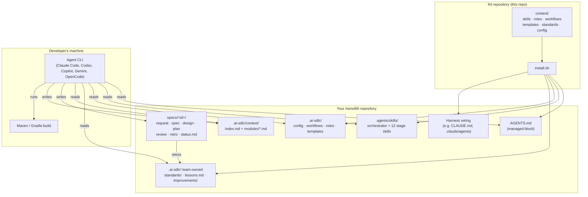
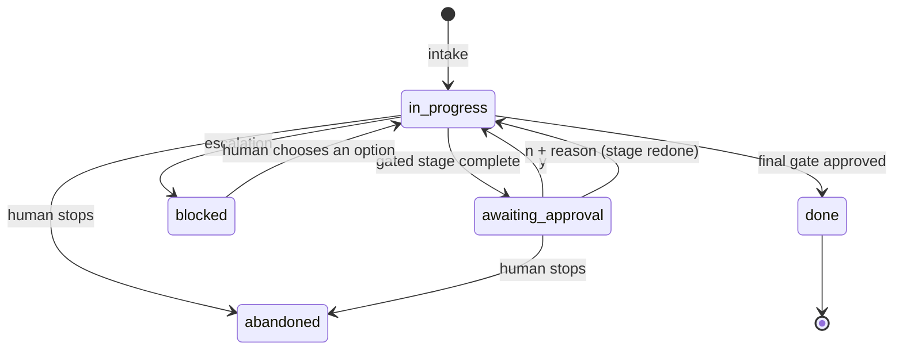
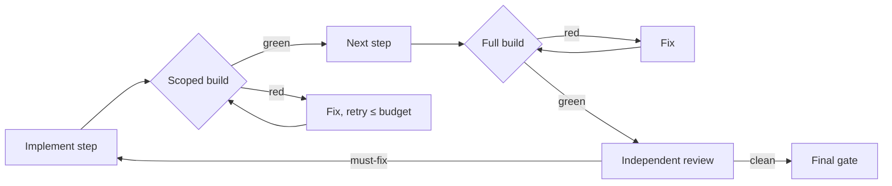
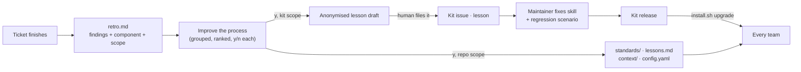

# Solution design

How Autonomous-SDLC-Java is designed and how it works. Read this to understand the system well enough to adopt it, extend it or review it. For usage, start with the [README](../README.md) and [Getting started](getting-started.md).

**Version:** 0.1 · **Status:** early, tested end to end on three real tickets (see [Evidence](#13-evidence))

---

## 1. Purpose and scope

### Problem

AI coding agents are good at writing code and poor at engineering process. Left to themselves ("vibe coding") they:

- start coding before anyone agrees what to build
- lose track of large codebases that do not fit in their context window
- mark their own homework, and report work as done when the build is red
- make silent decisions (a new library, a schema change) that a human should have made
- forget everything a team corrected them on, so the same mistakes repeat

These problems are worst on **Java monoliths**: large, old, under-tested codebases with tangled modules, slow builds and knowledge that lives in people's heads.

### Goal

A drop-in, open-source process that lets an agent take a ticket from request to a ready-to-review change in an existing Java monolith, where:

1. the human's job is **reviewing and answering yes or no** at the points that matter
2. every claim is **checkable** (cited code, real build results)
3. it works with **whichever local agent CLI** the developer already uses
4. it **gets better** from every rejection and correction, locally and for everyone

### In scope

- Java monoliths on Maven or Gradle (single-module, multi-module, or "multi-module in name only")
- Local agent CLIs: Claude Code, Codex CLI, Copilot CLI, Gemini CLI, OpenCode
- The developer inner loop: request → spec → design → plan → implement → test → verify → review → ready-to-merge change

### Out of scope

- A hosted platform, server, database or dashboard
- Replacing CI/CD, code review, SonarQube or deployment controls (they stay authoritative)
- Committing, pushing or merging (always a human action)
- Microservices and non-JVM stacks

---

## 2. Design principles

| # | Principle | What it means in practice |
| --- | --- | --- |
| P1 | **Author once, run in any harness** | All content is plain markdown in two cross-harness standards: `AGENTS.md` and [Agent Skills](https://agentskills.io) (`SKILL.md`). Harness-specific files are generated by the installer, never hand-written. |
| P2 | **Files are the state** | Every ticket is a folder, `specs/<id>/`, with a `status.md` that is the orchestrator's entire memory. Any session, in any harness, can resume from it. Everything is reviewable in git. |
| P3 | **The human decides, the agent proposes** | Gates ask yes/no on complete artifacts. Real choices are made by the human, never assumed silently. |
| P4 | **Enforce with tools, not prose** | "Done" means the build and tests are green, not that an agent says so. Protected paths, permissions and build commands are configuration, not hope. |
| P5 | **Small context per task** | Monoliths never fit in a context window. Context is split per module; agents load an index plus only the modules a task touches. |
| P6 | **Independent review** | Reviewer and security agents run in separate contexts and never see the implementer's reasoning. |
| P7 | **Learn from every correction** | Rejections, edits and misses become retros, then approved improvements to the team's standards, and upstream fixes to the kit. |
| P8 | **Honesty over polish** | Agents must say what they did not verify ("not run: no Docker", "regression guard, not seen failing"). |

---

## 3. Architecture



The kit is **content plus an installer**. There is no runtime component of its own: the agent CLI is the runtime, and the files are the program and its state.

### Installed layout

```text
your-monolith/
├── AGENTS.md                    # managed block: where things are + rules that always apply
├── .agents/skills/              # orchestrator + stage skills (Agent Skills format)
├── .ai-sdlc/
│   ├── config.yaml              # build commands, gates, protected paths, escalations, feedback
│   ├── workflows/               # defect.md, feature.md, refactor.md
│   ├── roles/                   # architect, implementer, tester, reviewer, security
│   ├── templates/               # status, spec, design, plan, review, retro, PR, context
│   ├── standards/               # engineering, testing, security        (team-owned)
│   ├── lessons.md               # facts learned in this repo             (team-owned)
│   ├── improvements/            # decision log + upstream lesson drafts  (team-owned)
│   ├── context/                 # index.md + modules/*.md                (generated, reviewed)
│   └── VERSION                  # installed kit version
├── specs/<id>/                  # one folder per change
└── CLAUDE.md, .claude/          # only with --harness claude
```

**Managed** files (skills, workflows, roles, templates, the `AGENTS.md` block) are replaced on upgrade. **Team-owned** files (config, standards, lessons, improvements, context, specs) are created once and never overwritten.

---

## 4. Components

### 4.1 Installer (`install.sh`)

A POSIX-ish bash script with no dependencies beyond `git`, `awk` and `sed`.

| Responsibility | Behaviour |
| --- | --- |
| Detect build | Maven if `pom.xml`; Gradle if `build.gradle*` / `settings.gradle*` |
| Detect layout | Multi-module if the root POM has `<modules>` or Gradle settings has `include`; otherwise single-module |
| Detect wrapper | Uses `./mvnw` / `./gradlew` if present, else `mvn` / `gradle` |
| Detect formatter | Pre-fills `format:` for Spring Java Format or Spotless |
| Write config | Fresh `config.yaml` with build commands matching the layout (only if absent) |
| Install managed content | Skills, workflows, roles, templates; `AGENTS.md` block (replace between markers, or append) |
| Install team-owned files | Standards, lessons, improvement log (only if absent) |
| Harness wiring | `--harness claude`: `CLAUDE.md` importing `AGENTS.md`, skills copied to `.claude/skills/`, roles rendered to `.claude/agents/`, default permissions in `.claude/settings.json` |
| Record version | `.ai-sdlc/VERSION` from `git describe` of the kit |

Re-running it is the upgrade path. `tests/run.sh` covers all four layouts and the upgrade guarantees.

### 4.2 Orchestrator (`skills/ai-sdlc`)

The only skill a developer invokes (`/ai-sdlc` or "start ai-sdlc"). It behaves like an application inside the harness:

```text
ai-sdlc · billing-monolith · 1 ticket in progress

What do you want to do?
  1  Fix a defect
  2  Build a feature
  3  Refactor
  4  Resume JIRA-118 (awaiting_approval at G2 · design)
  5  Improve the process (2 new retros)
```

It **coordinates and does no specialist work itself**. It reads config, status files and stage summaries, delegates each stage to a role subagent with only that stage's inputs, records results in `status.md`, and stops only for gates, escalations and the menu. Its reference files define the contracts: [status format](../content/skills/ai-sdlc/reference/status-format.md), [approval card](../content/skills/ai-sdlc/reference/approval-card.md), [escalation rules](../content/skills/ai-sdlc/reference/escalation.md).

### 4.3 Roles

Roles are agent definitions with neutral frontmatter, rendered into each harness's subagent format.

| Role | Stages | Writes | Never |
| --- | --- | --- | --- |
| architect | context, spec, design, plan | `specs/`, `.ai-sdlc/context/` | production or test code |
| tester | reproduce, characterise, test | test sources, `specs/` | production code |
| implementer | implement (one plan step at a time) | production + test code for that step | protected paths, characterisation tests, commits |
| reviewer | review | `review.md` | anything else |
| security | security | `## Security` in `review.md` | anything else |

```yaml
---
name: reviewer
description: Independently reviews a finished change ...
tools: [read, search, shell, edit]     # abstract; mapped per harness
readonly: true
model: strong                          # strong | fast; mapped per harness
skills: [sdlc-review]
---
```

### 4.4 Stage skills

| Skill | Purpose | Output |
| --- | --- | --- |
| `sdlc-context` | Map the codebase into small per-module files, every claim `[verified: path:line]` or `[inferred]` | `.ai-sdlc/context/` |
| `sdlc-spec` | What to build: testable acceptance criteria, input cases, scope, assumptions | `spec.md` |
| `sdlc-design` | How: components, patterns followed, boundaries, weighty changes, input binding, risks | `design.md` |
| `sdlc-plan` | Small ordered steps, each with files, module and a done-when check | `plan.md` |
| `sdlc-reproduce` | A test that fails for the reported reason | `reproduction.md` + failing test |
| `sdlc-characterise` | Tests pinning current behaviour before a refactor | `characterisation.md` + tests |
| `sdlc-implement` | One plan step, verified with the scoped build | code change |
| `sdlc-test` | Every acceptance criterion covered by a real test | tests + coverage table |
| `sdlc-review` | Independent review: correctness, tests, scope, boundaries, user-visible behaviour | `review.md` |
| `sdlc-security` | Review of the change for common Java web risks | `## Security` section |
| `sdlc-retro` | Attributed findings from a finished ticket | `retro.md` |
| `sdlc-improve` | Grouped improvement proposals, applied locally on `y`, drafted upstream | standards, lessons, drafts |

### 4.5 Workflows (tracks)

| Track | Stages | Default gates |
| --- | --- | --- |
| **defect** | reproduce → plan → implement → verify → review → final | plan, final |
| **feature** | spec → design → plan → implement → test → verify → review → security → final | spec, design, plan, final |
| **refactor** | characterise → plan → implement → verify → review → final | plan, final |

Each workflow file is a table of stage, role, skill, inputs and output. The orchestrator executes it; teams can change which stages are gated in `config.yaml`.

### 4.6 Configuration (`config.yaml`)

| Section | Purpose |
| --- | --- |
| `build` | `verify` (full), `verify_module` (scoped, with `{module}` / `{tests}`), `test_one`, `format` |
| `gates` | Which stages need a human yes/no, per track |
| `orchestrator` | `retry_budget` per step, `quick_fix_max_lines` for track fit |
| `escalate_on` | Changes that always stop for approval (new dependency, library, schema, protected path, high-severity finding) |
| `protect` | Paths agents must not edit without a recorded approval |
| `feedback` | Upstream repo, draft/file/off, proposals per session |
| `modules` | Logical modules with `paths` and a `tests` pattern for scoped builds |

---

## 5. State model

`specs/<id>/status.md` is a YAML front matter plus an append-only log. It holds everything needed to resume: track, modules, base commit, current stage and state, gate, retries, approvals and the log.



Rules that make it reliable:

- Updated after **every** stage, gate and escalation; timestamps come from `date`, never memory.
- `base_commit` is recorded at intake; reviews diff against it.
- `approvals:` lists exceptions approved for this ticket (for example a protected path), which implementer and reviewer honour.
- The artifact as the agent wrote it is snapshotted to `history/` before each gate, so later human edits are visible to the retro.

---

## 6. Gates and escalations

### Gates

A gate shows one **approval card**, always printed in full as the last thing in the message:

```text
GATE 2/4 · Design · JIRA-123 Add invoice PDF export
What:     New PdfExportService in billing; endpoint GET /invoices/{id}/pdf
Why:      Spec AC-1..AC-3; reuses existing InvoiceRepository
Touches:  billing (new code), web (1 controller) · no new module dependency
Evidence: entry points checked · module build green
Decide:   PDF library: OpenPDF (LGPL) chosen over iText (AGPL)
Full:     specs/JIRA-123/design.md

Approve? [y / n]
```

- **Every Decide item states what `y` approves.** Open questions are not allowed at a gate (lesson from the feature trial): a real either/or becomes an escalation first.
- **n** takes one of four reasons (wrong scope, wrong approach, missing case, other + text); the stage is redone and the card shown again. Two rejections of the same gate trigger one clarifying question instead of a third guess.
- Ambiguous replies ("ok", "looks fine") are never treated as approval.

### Escalations

Outside gates, the orchestrator stops only for: retry budget exhausted, new cross-module dependency, new library, schema migration, protected path, unresolved high-severity finding, wrong track, or an impossible plan step. Escalations show numbered options. On the feature track, dependency, schema and protected-path decisions are folded into the design gate as explicit Decide items and recorded under `approvals:`.

### Automatic loops (no human)



---

## 7. Context strategy for monoliths

1. **Build facts first.** The context skill reads build files and confirms the build commands actually work for this layout, then runs the scoped build once.
2. **Modules of 20–150 classes.** Each build module is a module; any build module over ~150 classes is split into logical modules by package. That covers single-module apps and apps that are "multi-module in name only" (Apache Roller: one module holds 564 of 565 classes).
3. **Per-module files** with purpose, entry points, key classes, data owned, dependencies, tests, gotchas and open questions; every claim cited or marked inferred.
4. **Index** with module map, allowed dependencies and **package cycles**, because the compiler will not stop new cross-package imports inside one build module.
5. **Scoped builds** per logical module via test patterns (Roller: 11 s scoped vs 1 min 52 s full).
6. Agents load `index.md` plus only the modules a task touches.

---

## 8. Verification model

| Level | When | Who decides it passed |
| --- | --- | --- |
| Reproduction / characterisation tests | Before any production change | The test runner (must fail / must pass on original code) |
| Scoped module build | After every plan step | Exit code of `verify_module` |
| Full build | After all steps and after every fix | Exit code of `verify` |
| Independent review | After a green full build | Reviewer in a fresh context, from spec, plan and diff only |
| Security review | Feature track | Security agent in a fresh context |
| Human | Gates | The human |

Build commands are never piped through `head`/`tail`: an exit code that was not seen is not green. Tests that cannot run (no Docker) are reported as "not run", never as passing.

---

## 9. Harness model

| Harness | Instructions | Skills | Roles → subagents | v0.1 status |
| --- | --- | --- | --- | --- |
| Claude Code | `CLAUDE.md` imports `AGENTS.md` | `.claude/skills/` (copied) | `.claude/agents/*.md` (rendered) | **Tested end to end** |
| Codex CLI | `AGENTS.md` (native) | `.agents/skills/` (native) | roles run as skills in the main session | Expected to work, untested |
| Copilot CLI | `AGENTS.md` | `.agents/skills/` | roles run as skills | Expected to work, untested |
| Gemini CLI | `GEMINI.md` → `AGENTS.md` | `.agents/skills/` | roles run as skills | Expected to work, untested |
| OpenCode | `AGENTS.md` (native) | `.opencode/skills/` | roles run as skills | Expected to work, untested |

**Graceful degradation:** without subagents, the orchestrator runs each role's skill itself and reviews from the diff and spec only. Without a native question tool, menus and cards are plain text answered with a number, `y` or `n`. Rendering roles into Codex, Copilot and Gemini agent formats is on the roadmap.

---

## 10. Feedback loop (self-improvement)



- **Capture:** gate rejections with the human's words, human edits to artifacts (diffed against snapshots), escalations, retries, must-fix findings, misses, unverified claims, and one optional end-of-ticket question.
- **Attribute:** each finding names a component (`skill:sdlc-review`, `standard:testing`, `policy:gates`, `context:…`, `lessons`) and a scope (`repo`, `kit`, `both`).
- **Improve with approval:** at most five proposals per session, each with evidence and the exact text it adds. Rejected proposals are logged and not re-proposed without new evidence. Fixes already in the installed kit are skipped.
- **Never lose local learning:** installed skills are never edited locally; the local fix lives in team-owned files and the real fix goes upstream.
- **Privacy:** drafts are anonymised files; nothing is posted without a second explicit yes.

Full description: [feedback-loop.md](feedback-loop.md).

---

## 11. Safety and governance

| Control | Mechanism |
| --- | --- |
| No commits, pushes, merges or branch changes | Rule in `AGENTS.md` and every role; `ask` in default Claude permissions |
| Protected paths | `protect:` in config; edits need an entry in the ticket's `approvals:`; unlisted edits are must-fix in review |
| Weighty changes need a human | `escalate_on:` (dependency, library, schema, protected path, high severity) |
| Independent checking | Separate reviewer and security contexts |
| Least privilege | Default permissions allow builds and read-only git; destructive commands ask |
| Audit trail | `specs/<id>/` artifacts, `status.md` log, `history/` snapshots, improvement log, all in git |
| Existing controls stay authoritative | CI, code review, SonarQube etc. are untouched; the agent never opens or merges PRs |
| No telemetry | Nothing leaves the repo unless a human sends it |

---

## 12. Extending

| To add | Do this |
| --- | --- |
| A team rule | Edit `.ai-sdlc/standards/*.md` (or approve an improvement proposal) |
| A stage skill | Add `content/skills/<name>/SKILL.md`; reference it from a workflow table and a role's `skills:` |
| A track | Add `content/workflows/<track>.md`, a `gates.<track>` entry, and a menu line in the orchestrator |
| A harness adapter | Add a case to the harness section of `install.sh` rendering roles into that harness's agent format |
| A regression scenario | Add `docs/scenarios/s<n>-<name>.md` with pinned repo, ticket, answers, must and must-not |

Run `./tests/run.sh` before opening a PR.

---

## 13. Evidence

All trials used real public repositories and Claude Code (headless, Sonnet 5.5). Every result was re-checked independently.

| Trial | Ticket | Result | Human input | Agent cost |
| --- | --- | --- | --- | --- |
| [Spring PetClinic, defect](trials/2026-10-12-spring-petclinic.md) | Padded pet names bypass duplicate check | Reproduced with 4 failing tests; 2-line fix; one rejection and rework; build green | 3 answers + 1 reason | ~$1.50 |
| [Spring PetClinic, feature](trials/2026-10-12-spring-petclinic-feature.md) | Record which vet a visit is with | 24 files, cross-module dependency and schema change approved at design; security review caught a mass-assignment bug; 103 tests green | 7 answers | ~$4.50 |
| [Apache Roller, refactor](trials/2026-10-12-apache-roller-refactor.md) | Split a 1,114-line utility class | 48 characterisation tests green on original code; 3 latent bugs found and preserved; 536 tests green | 3 answers | ~$2.00 |
| [Feedback loop](trials/2026-10-12-feedback-loop.md) | Retros + improvement over two tickets | 5 proposals, 4 applied, 1 rejected; 3 anonymised lessons filed upstream and fixed in the kit | 5 answers | ~$1.00 |

Each trial also found kit problems, which were fixed and turned into [regression scenarios](scenarios/).

---

## 14. Known limitations and roadmap

**Limitations (v0.1)**

- Only Claude Code is tested end to end; other harnesses rely on `AGENTS.md` and skills with roles run inline.
- No deterministic Java analyser yet: context relies on the agent reading code (with mandatory citations).
- Scenario replay is manual.
- Hooks (format on edit, block protected paths, verify on finish) are not yet installed; enforcement is by rules, permissions and review.
- Database integration paths that need Docker are reported as not run when Docker is missing.

**Roadmap**

- **v0.2** `ai-sdlc init`: Java analyser (Maven/Gradle model, JavaParser, git hotspots) producing `codemap.json` and an ArchUnit baseline for module boundaries
- **v0.3** Role rendering for Codex, Copilot and Gemini; neutral hooks; tested runs on Codex CLI
- **v0.4** `verify`, `doctor` (context drift), automated scenario replay
- **Later** external driver for parallel tickets and asynchronous approvals (Slack, PR comments)
